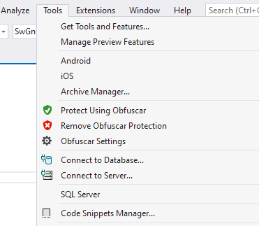
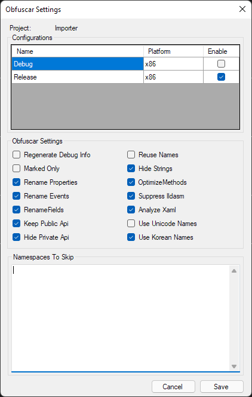

# ObfuscarTools
Obfuscar Tools for Visual Studio

Obfuscar for Visual Studio integrates the free and open source Obfuscar protector into Visual Studio for easy automatic obfuscation of release builds and ClickOnce applications.

Obfuscar 2.2.50 is included with this extension. Obfuscar is available from https://github.com/obfuscar/obfuscar

**Requirement:** building an obfuscated configuration needs the .NET 10 runtime (x64) or later, including for .NET Framework projects.

Works with .NET (SDK-style) and .NET Framework projects, including WPF single-file publish. Assembly search paths are added automatically during the build. The obfuscated assembly is what gets copied to the output folder and published.

Debugging will not work on obfuscated executables or libraries. Use Ctrl+F5 to run without debugging.

## How to Use

Download and install the extension from the Visual Studio Marketplace

[https://marketplace.visualstudio.com/items?itemName=AvinabMalla.obfuscarvs](https://marketplace.visualstudio.com/items?itemName=AvinabMalla.obfuscarvs)

Three new items are added to the Tools menu.

Click "Protect Using Obfuscar" to set the current project's current configuration for obfuscation after release builds.

Click "Remove Obfuscar Protection" to stop automatic obfuscation for the current configuration.

"Obfuscar Settings" Will let you tune the obfuscar settings. You can select the configurations to enable obfuscar for, and also enter namespaces to skip.

## What it changes in your project

- A `_Obfuscar` folder with Obfuscar, `Obfuscar.targets` and your settings in `obfuscar.xml`. Keep it with the project.
- At the end of the project file, an `ObfuscarEnabledFor` property and an import of `_Obfuscar\Obfuscar.targets`.

The mapping file, useful for decoding stack traces, is written to `obj\...\Obfuscated\Mapping.txt`. Do not publish it.

## Upgrading from version 1.x

Open "Obfuscar Settings" and click Save once. The old build commands are replaced. SDK-style projects were not obfuscated by version 1.x, so test the obfuscated build before releasing it.

## WPF

New WPF projects keep property names (`RenameProperties` off), and `AnalyzeXaml` is on. Existing settings are not changed. Data bindings and reflection depend on names, so exclude affected types with a namespace in the settings dialog, a `SkipType` element in `obfuscar.xml`, or `[Obfuscation(Exclude = true)]`.

WPF looks up handlers by name for events set in XAML on a control defined in the same project, such as `<local:MyControl Drop="OnDrop" />`. Renaming such a handler makes the app crash with `XamlParseException: Failed to create a 'Drop' from the text 'OnDrop'`. Mark each one with `[System.Reflection.Obfuscation(Exclude = true)]`, or attach it in code (`control.Drop += OnDrop;`).

Referenced class libraries are not obfuscated. Trimming is not supported by WPF.
